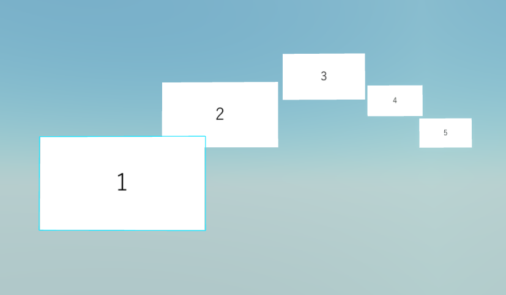

# SlideSpace

English: [README.md](README.md)



SlideSpaceは、3D空間にスライドやモデルを配置できるブラウザベースのプレゼンテーション編集アプリです。Babylon.jsを利用し、SPZ形式のGaussian Splatting、GLBモデル、Scene Preset、カメラ操作、音声、描画・発表機能などに対応しています。

## 必要な環境

- Vite 7に対応したNode.js（**20.19以上**または**22.12以上**。その他の新しい対応バージョンも可）
- npm
- WebGL対応ブラウザ。フォルダ選択・保存にはFile System Access APIへの対応と適切なセキュアコンテキストが必要です。デスクトップ版のChromium系ブラウザを推奨します。

## 起動方法

```bash
npm ci
npm run dev
```

Viteが表示するURL（通常は `http://localhost:5173/`）をブラウザで開いてください。

## 主な機能

- 3D空間でのスライド・アセットの配置と操作
- SPZのGaussian Splatting・GLBモデルの読み込み
- Camera、Scene Preset、Transition、Slide Override
- Audio Library、BGM、効果音、6面Skybox Library
- 保存済みCamera Poseを変更しないFraming Offset
- Undo/Redo、描画、プレゼンテーション操作、日英UI
- 対応ブラウザでのプロジェクト保存・再読み込み
