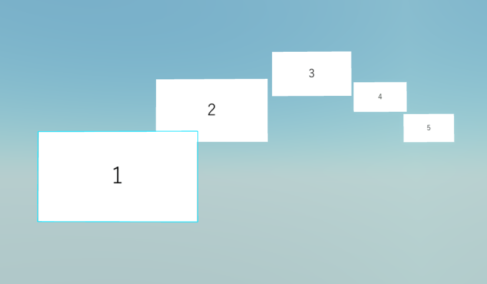

# SlideSpace

日本語版: [README.ja.md](README.ja.md)



SlideSpace is a browser-based spatial presentation editor. It combines 3D slides and assets, Babylon.js rendering, Gaussian splatting (SPZ), GLB models, scene presets, camera controls, audio, drawing, and presentation tools.

## Requirements

- Node.js compatible with Vite 7 (Node.js **20.19+** or **22.12+**; newer supported versions also work)
- npm
- A modern browser with WebGL support; project-folder workflows require the browser's File System Access API and an appropriate secure context. Chromium-based desktop browsers are recommended for those features.

## Run locally

```bash
npm ci
npm run dev
```

Open the URL shown by Vite (typically `http://localhost:5173/`). 

## Features

- Arrange slides and 3D scene assets in a shared spatial workspace
- Load GLB models and SPZ Gaussian-splatting assets
- Control camera, transitions, scene presets, and per-slide overrides
- Manage audio tracks, sound effects, and six-face Skybox library sets
- Adjust camera framing offset without rewriting saved camera poses
- Use undo/redo, drawing and presentation controls, and Japanese/English UI
- Save and reopen project settings and associated local assets using supported browser APIs
